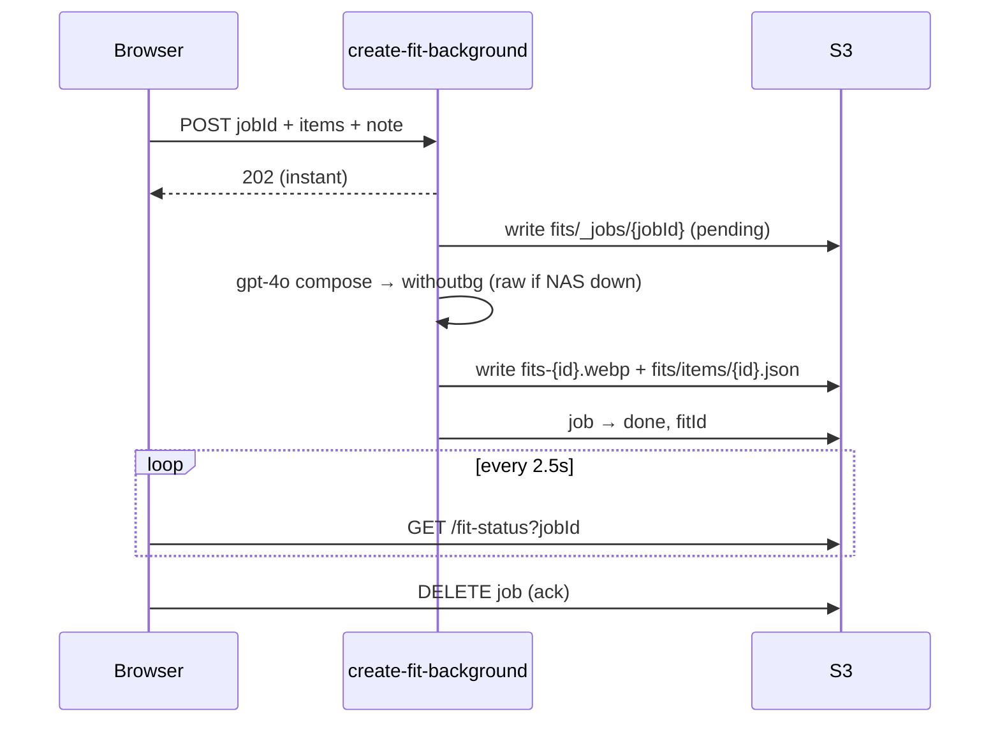
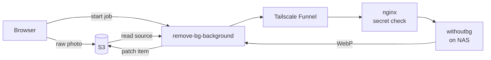
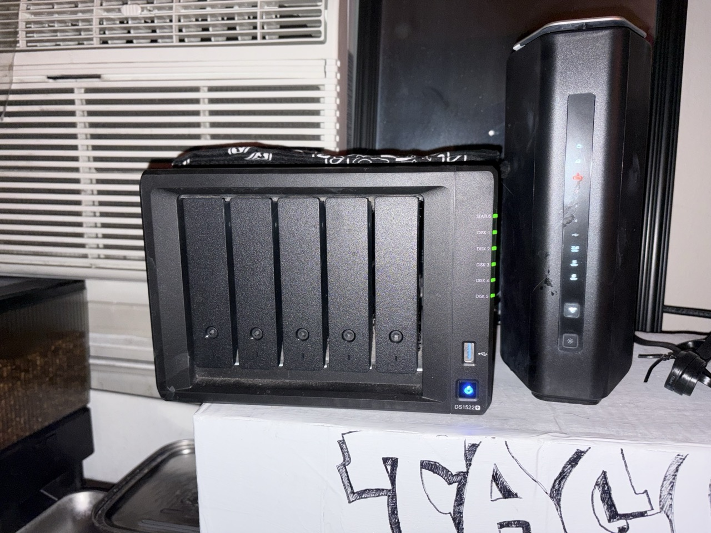

# toop-closet

A shareable virtual closet. Photograph every piece of clothing you own, tag it, and browse it from anywhere — then let AI dress a model in any combination of it, or pack a trip and style outfits from only what's in the bag.

Built after spring cleaning left a pile of clothes headed to my parents' house: I wanted to know what's where without digging through boxes.

**Live:** https://closet.tooper.io &nbsp; [](https://app.netlify.com/projects/toop-closet/deploys)

https://github.com/user-attachments/assets/3a6b0e31-c757-4b60-a301-f755a87ffec1

## Features

| Public (no login) | Signed in (invite-only) |
|---|---|
| Browse any closet by URL, filter by tag | Add/edit/delete items: name, tag, note, up to 4 photos |
| Swipeable cards + fullscreen lightbox | Automatic background removal on every photo |
| Browse AI-generated **fits** and packed **suitcases** | Multiple closets with custom tags; move items between them |
| One-tap share links with rich previews | Generate **fits** from items across closets |
| | Pack **suitcases** and generate fits from only what's packed |
| | **Workspaces**: share yours with collaborators via seats |

## Stack

| Layer | Tech |
|---|---|
| Frontend | React 19, Vite, Tailwind v4 |
| Backend | Netlify Functions (sync, background, scheduled) + edge function for OG tags |
| Storage | AWS S3 (JSON records + images) |
| Auth | Netlify Identity (invite-only JWT) |
| Background removal | [withoutbg](https://github.com/withoutbg/withoutbg) on a Synology NAS, via Tailscale Funnel |
| Fit generation | OpenAI `gpt-4o` image generation |

## How it works

Each closet has a permanent hex slug (`/a472ae`) that is both its URL and its S3 key. Reads are public; writes need login **and** membership in the owning workspace. Images upload straight from the browser to S3 via a presigned URL and never pass through a function.

### S3 layout

```
toop-closet/                        ← the bucket
│
├── inventory/
│   └── {slug}.json                 ·  item list for one closet
│
├── users/
│   └── {slug}/config.json          ·  owner email · categories · display name
│
├── _users/
│   └── seats.json                  ·  workspace registry — owner → collaborators
│
├── fits/
│   ├── items/{id}.json             ·  one object per fit  ─┐ no shared index,
│   └── _jobs/{jobId}.json          ·  transient jobs       ┘ so concurrent
│                                                             writes can't race
├── suitcases/
│   └── items/{id}.json             ·  one packed trip (item snapshots)
│
└── clothing/
    ├── {slug}/{uuid}               ·  item photos          (public read)
    └── fits-{id}.webp              ·  composed fit images  (public read)
```

### Workspaces & auth

- A **workspace** is an owner email. Every closet, fit and suitcase is stamped with one.
- You can act in your own workspace plus any whose `seats` list you; the UI switches between them.
- Not seated anywhere → isolated tenant. Edit `seats.json` to invite; no redeploy.
- Lists (`/fits`, `/suitcases`) are workspace-scoped; a single fit or suitcase by id is unscoped, so share links work for anyone.

### Share links

| Link | Opens |
|---|---|
| `/{slug}?item={8-char id}` | item lightbox |
| `/fits?fit={id}` | fit |
| `/suitcases/{id}?fit={id}` | suitcase fit |

Link-preview bots don't run JS, so an edge function injects `og:` tags (name, image) into the HTML.

## AI fits

Pick items, add an optional styling note, and `gpt-4o` renders them worn together on a base subject (`public/base-subject.webp`). Generation outlasts a normal function's timeout, so it runs in a 15-min background function that **commits the fit itself**. The browser only watches: reload, close the tab, or switch devices and the fit still lands.



- Job file is written **first**, so on load the client re-adopts in-flight jobs.
- Background functions always return 202; every failure is written to the job file or it's invisible.
- Regenerate overwrites the same image key; `?v=` on `imageUrl` busts caches.

## Suitcases

A named set of items packed from any closet. Its page lists the packed items and the fits made from them, and its fit builder only offers what's packed. Suitcase fits are siloed: hidden from `/fits` and deleted with the suitcase.

## Background removal

Self-hosted [withoutbg](https://github.com/withoutbg/withoutbg) in Docker on a Synology DS1522+ for a consistent look with no manual editing.



- Item saves immediately with the raw photo; removal runs async.
- Progress lives on the item (`bgPendingAt`), so every device shows the spinner.
- Failure keeps the raw photo and records unfinished slots; **Retry** in the card menu reruns them without re-upload.
- Tailscale Funnel gives the NAS a stable HTTPS hostname: no port forwarding, no static IP.
- Photos are resized client-side to ≤1500px / JPEG 0.85 first (an iPhone HEIC breaks Netlify's 6MB body limit).

<p align="center"></p>

## Orphan cleanup

Deleting a record never deletes its images inline (fit and suitcase snapshots may still point at them). Strays are tagged `orphaned=true` and reaped by S3 lifecycle rules.

| Mechanism | What it reaps |
|---|---|
| Lifecycle `expire-fit-jobs` | everything under `fits/_jobs/` after 1 day |
| Lifecycle `expire-orphaned-images` | any object tagged `orphaned=true` after 1 day |
| Tag on delete | a deleted fit's composite (incl. suitcase cascade) |
| Weekly `sweep-orphans` (scheduled fn) | `clothing/` photos older than 24h that no inventory, fit, suitcase or pending job references |

The sweep aborts with nothing tagged on any read failure, re-reads references right before tagging, and only logs until `ORPHAN_SWEEP=live`.

https://github.com/user-attachments/assets/e52cdc9c-ac42-45f1-858b-7072b894cf0a

## Setup

Requires [mise](https://mise.jdx.dev) and the 1Password CLI.

```bash
mise install                          # Node 24
mise run setup                        # secret-scanning hook + npm ci
op inject -i .env.tpl -o .env.local   # secrets from 1Password (Dev vault, item toop-closet)
mise run dev                          # http://localhost:8888
```

Variables are listed in `.env.example`. Local dev bypasses Identity: `OWNER_EMAIL` becomes a fake signed-in user.

| Task | Command |
|---|---|
| Build | `mise run build` |
| Lint + typecheck | `mise run lint` |

## Credits

- [withoutbg](https://github.com/withoutbg/withoutbg): open-source background removal in one Docker container
- [Tailscale](https://tailscale.com): exposes the NAS to the internet in two commands
